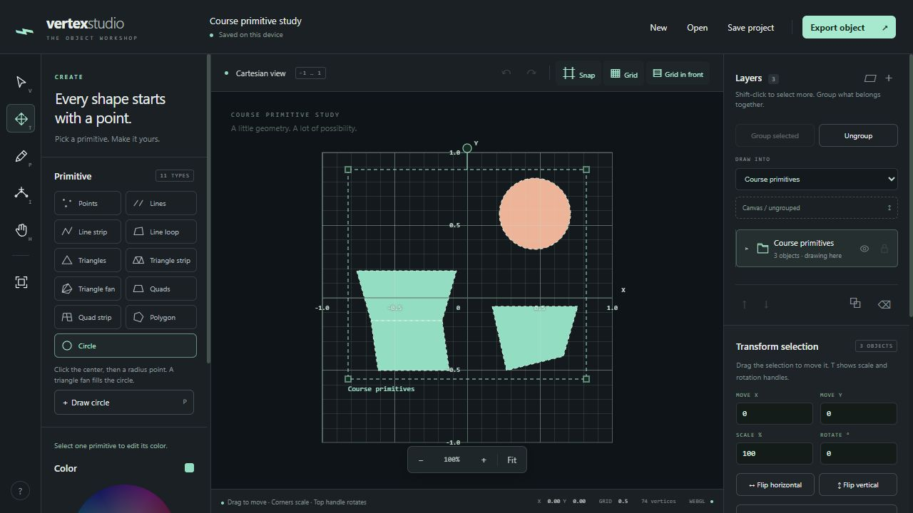

# Vertex Studio

An offline 2D object editor: plot vertices, choose colors, arrange layers and folders, then export a reusable OpenGL object.



## Open the editor

Double-click **Launch.cmd**, or open **index.html** in a WebGL-capable browser. No editor libraries or downloads are required. Optionally run `node server.js` and visit the address it prints.

## Basis in the supplied course modules

All eight PDFs in `D:\MSV\CGVC Notes` were reviewed (296 slides). The editor retains its existing browser interface; no new external libraries were added. Generated C++ uses the course's GLUT/OpenGL approach.

| Module | Material reviewed | Application here |
| --- | --- | --- |
| 1 — 32 slides | Rendering pipeline; basic GLUT application; coordinate system | A GLUT window, display callback, event loop, and normalized editing canvas. See slides 24–31. |
| 2 — 38 slides | Points, lines, filled primitives, RGBA, point/line sizes | All primitive modes, colors and native C++ sizes. Quads/quad-strip order follows slides 28–31; the circle is built from the triangle fan in slides 26–27. |
| 3 — 36 slides | GLUT text, window setup and input callbacks | The exported program follows the event-driven GLUT window/display structure; it does not add unnecessary input or text features. |
| 4 — 22 slides | Client vertex arrays, glVertexPointer, glDrawArrays, indexed drawing | Simple `GLfloat` position arrays and `glDrawArrays`, following slides 8–12 and 21–22. |
| 5 — 48 slides | VBOs, GLEW and mapped buffers | Reviewed; a static exported object uses Module 4's simpler arrays, so it does not need GLEW or VBO management. |
| 6 — 46 slides | Matrix arithmetic, translation, scaling, rotation, color arrays | Coordinate transformations, including mirroring as negative scaling. See slides 22–27. |
| 7 — 41 slides | Transformations, matrix stacks, viewport, projections | Shared selection transforms and an aspect-preserving square export viewport. See slides 3–13 and 19–25. |
| 8 — 33 slides | Lighting, materials, texture mapping | Reviewed; these are unnecessary for the requested flat-color 2D object and are not added to its export. |

Circle is an editor convenience, not an OpenGL primitive constant. The editor samples 64 boundary points and exports a closed `GL_TRIANGLE_FAN`. Its coordinates are already calculated, so the C++ file needs no circle or math library. Horizontal/vertical flips apply negative X/Y scaling around the selection center and save the resulting coordinates.

## Plot and edit

Choose one of **11 primitives**, press **P** or **Draw**, and click inside the canvas. **Enter**, double-click, or **Finish** completes ordinary primitives. **Escape** cancels; **Backspace** removes the last draft point.

- **Quads:** plot four corners around each convex quadrilateral, in clockwise or counterclockwise order. Additional groups of four create more quads on that layer.
- **Quad strip:** plot pairs across the strip, then the next pair. The first quad uses vertices 1, 2, 4, 3; the next uses 3, 4, 6, 5. At least four vertices and an even count are required. Each face must be convex.
- **Circle:** click its center, then a radius point. The second click completes it automatically. The entire circle must fit inside the canvas. Editing a circle's individual boundary vertex converts it to an editable polygon on the same layer.
- **Points / lines:** points accept any count; lines use pairs. Line strip connects successive points; line loop closes the outline.
- **Triangles / strips / fans:** triangles use groups of three; strips and fans need at least three points. Polygon accepts a simple outline, including concave shapes.

Press **V** to select. Drag a vertex or enter exact X/Y coordinates in the inspector. The color wheel, brightness, hex color and opacity edit the selected primitive or your next primitive. Point and line primitives reveal a **Point size** or **Line width** control (0.5–64 pixels).

## Bounded Cartesian canvas

Both axes run from **−1 to +1**. The square border shows the valid drawing area; the space outside is shaded and cannot receive vertices. Numeric edits, dragging, scaling, rotation, duplication, saving and export respect this range. A group transform that would push any vertex outside is rejected as a whole.

Zooming changes decimal grid spacing, not the coordinate limits. Snap follows the major grid spacing. Scroll or use **+ / −** to zoom, hold **Space** to pan, and press **F** to fit the artwork. Click the zoom percentage to show the complete plane again. **Grid in front** reveals the grid above filled objects; **Grid** controls grid-line visibility. Neither grid nor editing handles are exported.

## Add vertices to existing shapes

Select an outline and press **I**, or use **Add vertex on edge**. Click between existing corners to split an edge, then drag the new point. Each vertex row also has a **+** button for the outgoing edge's midpoint. Snap does not move a newly inserted point away from its edge.

Supported: polygons, circles, line loops, line strips, single triangles and single quads. Circles, single triangles and single quads become polygons when an extra vertex is inserted. Batches of quads/triangles and multi-face strips/fans keep their original topology and do not support insertion. Locked/hidden objects are protected. Adding and moving the point have separate undo steps.

## Select, flip, transform and organize

Shift-click layers/shapes to select several; drag a box from empty space to select the shapes it touches. **Ctrl+A** selects visible unlocked primitives. Drag selected objects to move them together.

Select a shape, multiple shapes, or a folder, then use **Flip horizontal** (left/right) or **Flip vertical** (top/bottom) in **Transform selection**. Mirroring uses the shared selection center, preserving spacing, layer order, colors and folder membership. **Undo / Redo** restores or reapplies a flip. Locked selections must be unlocked first.

Press **T** for corner scale handles and a rotation handle. Hold **Shift** while rotating for 15° increments. The inspector accepts exact move offsets, scale percentage and rotation. Point/line pixel sizes stay constant. Escape during a drag cancels it.

**Ctrl+G / Group selected** creates a folder; **New layer folder** creates an empty one. Click a folder header to select its parts. **Draw into** chooses where new primitives go. **Move selection to** or dragging layer rows changes folders. **Ctrl+Shift+G** ungroups. Folders are single-level containers and remain contiguous in the draw stack. Alt-click a grouped shape, or click its child layer, to edit one primitive.

Top layers draw in front. Layer arrows and row dragging change the order. Eye/lock controls affect visibility/editing, including folder children. **Ctrl+D** duplicates a selection (the offset is reduced at the boundary to keep it in range).

## Save and reopen

**Save project** downloads editable `.vstudio.json` containing source geometry, colors, sizes, folders, order, visibility and locks. New saves use version 3. Versions 1 and 2 still open.

Older projects with coordinates outside −1…1 are fitted proportionally into the canvas as one scene. Hidden objects are included in the fit, and relative spacing and folder membership are preserved. A message explains the conversion. The original downloaded file is unchanged. Save under a new filename to retain both versions. Opening another project can be undone. Version 3 rejects out-of-range coordinates instead of changing them.

Browser local storage recovers the most recent completed canvas for the current file/localhost origin. Download project files for a portable copy. Finish or cancel a draft before saving/exporting.

## Export and run C++

Choose **Export object → C++ / GLUT**. Export the entire visible canvas or only selected primitives/a selected folder. Hidden layers/folders are omitted; locked visible ones are included. Coordinates, transforms and painter's order are baked into the data.

The `.cpp` contains:

- One header: `#include <GL/glut.h>`.
- Plain `GLfloat` XYZ arrays (Z = 0), named `object1Vertices`, `object2Vertices`, etc.
- A reusable `drawObject()` function with color, point/line size, `glVertexPointer` and `glDrawArrays` calls.
- A short GLUT display callback, square viewport/orthographic reshape callback, and `main()` that opens the window.

Convex outlines use `GL_POLYGON`; concave outlines become `GL_TRIANGLES` for correct filling. Quads/quad strips retain their native OpenGL modes. Circle uses `GL_TRIANGLE_FAN`. Draw counts are vertex counts, not the number of coordinate floats.

Open your existing **OpenGL workspace folder** in VS Code. Open the exported `.cpp` as the active file, save it, and use your course build/run task. Merely copying a source file into a folder does not launch it. Build and run that active file; a program with a different `main()` must be built separately.

From a terminal using the course's **MSYS2 UCRT64** compiler and FreeGLUT:

```powershell
g++ object.cpp -o object.exe -lfreeglut -lopengl32
.\object.exe
```

Replace `object.cpp` with the downloaded filename. The MSYS2 UCRT64 `bin` directory must be on PATH when running, so FreeGLUT and its runtime DLLs can be found. Your existing course VS Code task may already link additional course libraries; the new export itself only requires FreeGLUT and OpenGL. It does not require GLEW, GLFW, GLAD, GLM, or a custom Windows windowing layer.

Resizing preserves the object's proportions in a centered square view. The coordinate range remains −1…1; viewer pan/zoom controls are intentionally omitted. Reuse the arrays and `drawObject()` in another program with an existing OpenGL context; keep depth testing off and draw back to front. Alpha blending is enabled in the sample's `main()`.

Point/line sizes use the course's native `glPointSize` / `glLineWidth`; supported widths and line joins depend on the OpenGL driver. The browser preview uses its existing triangle-based stroke drawing. This can produce small stroke differences between editor and C++ while avoiding extra export geometry/code.

## Other array formats

JavaScript and JSON exports retain the existing interleaved **X, Y, Z, R, G, B, A** layout: seven floats per vertex, 28-byte stride. Draw ranges include `first`, `count`, numeric `mode`, `lineWidth` and `pointSize`. These formats use WebGL-compatible triangles for polygons, quads and quad strips; circles use a triangle fan. Keep depth testing disabled and alpha blending enabled. The C++ format instead separates XYZ arrays and per-layer color calls for readability.

## Examples and checks

`examples` contains editable Alpine, grouped Alpine, point/line, and course primitive studies with matching C++ exports. `course-primitives.cpp` is a small example of the new modes. Recreate examples with `node create-example.cjs`.

```powershell
node --test geometry.test.js scene.test.js vertex-insertion.test.js course-features.test.js
node --check app.js
node verify-cpp.cjs "D:\MSV\msys\ucrt64\bin\g++.exe"
```

Tests cover geometry, topology, mirroring, range enforcement, legacy fitting, folders, insertion, save/reopen and exports. The C++ check builds and links exports for all primitives, an empty canvas and the bundled course example using only FreeGLUT/OpenGL, with compile-time vertex-count checks.

Files: `index.html` (interface), `style.css` (appearance), `app.js` (editing), `geometry.js` (geometry/export), `scene.js` (folders/transforms), `cpp-viewer.js` (course-style C++ generation), `server.js` (optional local preview).
